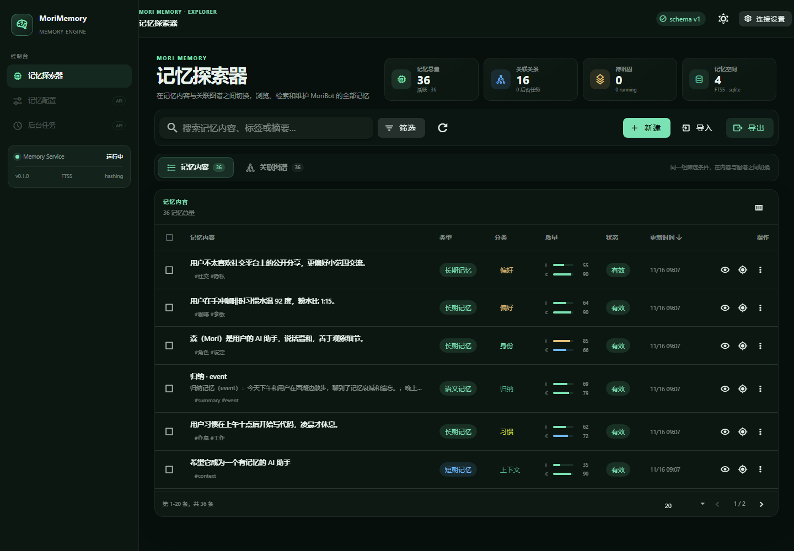
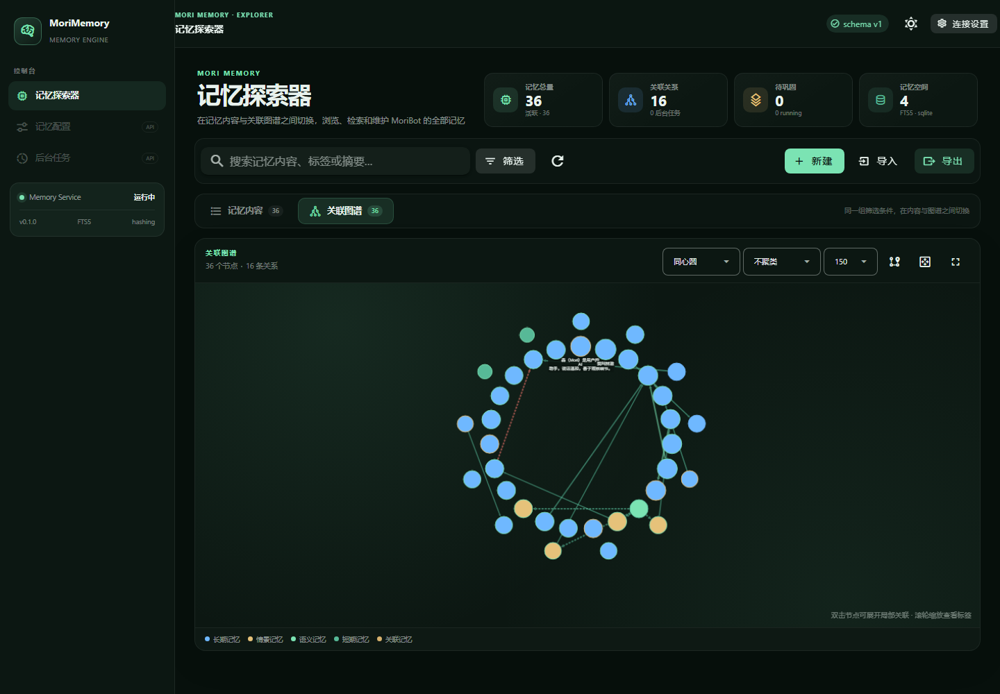

# MoriMemory

MoriMemory 是一个面向 [MoriBot](https://github.com/an-shi/MoriBot) 的本地优先记忆引擎。它以 FastAPI 提供独立服务，以 SQLite + FTS5 存储数据，通过可插拔 Embedding Provider 与向量索引实现关键词、语义、时间和关联关系的混合检索，并由 MoriBot 自动启动、代理和关闭。

> MoriMemory 只负责记忆管理，不负责 AI 回复生成和角色扮演。MoriBot 在生成回复前调用检索接口组装上下文，在回复完成后异步提交记忆提取任务。



## 核心能力

- **六级记忆模型**：工作、短期、长期、情景、语义、关联；与用户/角色/会话三级空间严格分离。
- **完整生命周期**：提取 → 分类 → 去重 → 矛盾检测 → 新建/强化/合并 → 巩固 → 衰减/软遗忘 → 硬删除。
- **证据与来源**：每条记忆至少一条证据，区分用户明确表达、AI 推断、行为观察、模型归纳；推断不会伪装成用户事实。
- **混合检索**：FTS5 关键词 + 可插拔向量语义 + 时间衰减 + 关系扩展 + 重要性/置信度/强化程度，带 Token 预算。
- **角色隔离**：后端强制空间权限；用户记忆可向指定角色授权共享，角色私有记忆互不可见。
- **内容 / 图谱双视图**：Cytoscape 图谱与 VDataTableServer 分成独立页面切换，通过定位动作双向联动；支持按需加载、局部展开、路径追踪、聚类、时间/类型/空间筛选。
- **独立组件包**：`@moriai/memory-ui`，Vue 3 + Vuetify 3，复用 MoriBot 实例，不使用 iframe，不创建第二套 UI。
- **嵌入式运行**：MoriBot 自动检查/启动/复用/关闭服务，进程锁防止重复实例，异常退出自动重启。
- **可迁移**：schema 版本、SQLite 在线备份、SHA-256 manifest、完整性校验、恢复安全副本、JSON/CSV 导入导出。
- **默认离线可用**：`hashing` embedding + SQLite 精确向量检索，无需任何外部服务即可启动。



> 浅色主题截图：[内容页](docs/images/memory-explorer-table-light.png) · [图谱页](docs/images/memory-explorer-graph-light.png)

## 快速开始

### 独立运行

```bash
uv sync --extra dev
uv run morimemory init
uv run morimemory token     # 保存输出的服务令牌
uv run morimemory serve
```

打开 `http://127.0.0.1:6190/api/docs`，健康检查 `GET /api/v1/health`。

```bash
# 可选：生成演示数据（自动启动本地服务；已在运行则直接复用）
uv run python scripts/seed_demo.py --reset --start
```

如果 Memory Service 已经在另一个终端运行，也可以直接：

```bash
uv run python scripts/seed_demo.py --reset
```

脚本会等待服务健康检查就绪，并在启动失败时提示查看 `data/logs/seed-service.log`，不会输出裸 JSON 异常。

> 如果终端设置了 `HTTP_PROXY` / `ALL_PROXY`，脚本会忽略环境代理访问本机
> `127.0.0.1`，无需修改全局代理设置。

### 前端组件开发

```bash
cd frontend
pnpm install
pnpm dev
```

打开 `http://127.0.0.1:5174`，粘贴服务令牌。

### 测试与构建

```bash
uv run pytest -q
uv run ruff check morimemory tests scripts
cd frontend && pnpm typecheck && pnpm build
```

## 在 MoriBot 中使用

MoriMemory 保持独立仓库和版本，但正式运行时由 MoriBot 托管：

1. MoriBot 启动时检查 Memory Service 健康状态；未运行则自动启动子进程。
2. MoriBot 将 `/api/v1/memory/*` 作为受 JWT 保护的代理，浏览器不接触服务令牌。
3. 前端 `@moriai/memory-ui` 直接挂在 MoriBot 的 Vue Router 中，复用宿主 Vuetify 主题。
4. MoriBot 退出时关闭服务；异常退出时检测并重启；进程锁防止多实例。

完整补丁点、配置、代理和页面代码见：

- [MoriBot 集成指南](integrations/moribot/README.md)
- [嵌入模式说明](docs/moribot-integration.md)

## 文档

- [架构设计](docs/architecture.md)
- [记忆模型与生命周期](docs/memory-model.md)
- [API 参考](docs/api.md)
- [Embedding、向量索引与混合检索](docs/embedding.md)
- [数据迁移、备份与恢复](docs/data-migration.md)
- [开发指南](docs/development.md)
- [前端组件包](frontend/README.md)

## 目录结构

```text
morimemory/
  api/            FastAPI 路由、认证、序列化
  db/             SQLAlchemy 模型、迁移、FTS5、Repository
  engine/         提取、检索、图谱、巩固、衰减、任务
  services/       备份、导入导出
  app.py          ASGI 工厂
  cli.py          serve / init / token / backup / migrate
frontend/         @moriai/memory-ui Vue 组件包
integrations/     MoriBot 生命周期管理器、代理、集成文档
docs/             设计与运维文档
scripts/          演示数据
tests/            后端测试
```

## 配置示例

`data/config.json` 首次启动自动生成。常用项：

```json
{
  "embedding": {
    "provider": "openai_compatible",
    "model": "text-embedding-3-small",
    "base_url": "https://api.openai.com/v1",
    "dimensions": 1536,
    "api_key_encrypted": "..."
  },
  "retrieval": {
    "default_token_budget": 2000,
    "weights": {
      "semantic": 0.35,
      "keyword": 0.2,
      "importance": 0.15,
      "confidence": 0.1,
      "recency": 0.1,
      "strength": 0.1
    }
  },
  "memory": {
    "decay": { "enabled": true, "half_life_days": 45 },
    "consolidation": { "enabled": true, "min_group_size": 3 }
  }
}
```

推荐通过 `PATCH /api/v1/config` 修改，API Key 会自动加密存储，读取接口只返回 `api_key_set`。

## 安全

- 默认只监听 `127.0.0.1`。
- 业务接口要求高熵 Bearer token；健康检查公开。
- 浏览器直连时校验 Origin 白名单。
- 管理操作要求 `admin` 角色；`recall` 模式由后端强制角色隔离。
- 嵌入模式由 MoriBot 代理层校验 JWT，服务令牌不下发浏览器。
- API Key 使用安装密钥派生的 Fernet 加密。

## 许可

MIT
